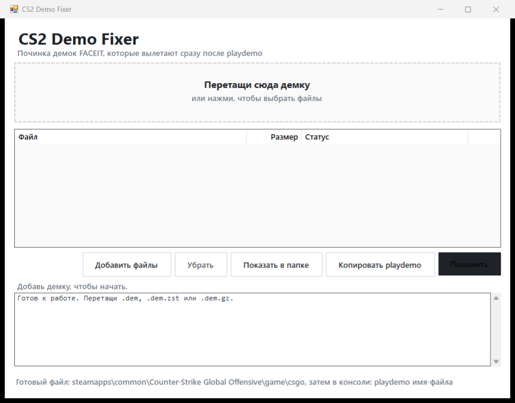

# CS2 Demo Fixer

Приложение для Windows, которое чинит демки CS2 (чаще всего с FACEIT), вылетающие сразу после команды `playdemo`.

GUI написано на WinForms. Движок починки — локальный Node.js-скрипт (`cli.js` + `demofix.js`), поэтому Node.js должен быть установлен. Интернет не используется, файлы никуда не отправляются.



## Почему вылетает демка

В обновлении Rush Hour (сентябрь 2026) в CS2 появились петухи-питомцы. Если игрок берёт такого петуха в матч, его `instancebaseline` приходит в первом игровом пакете, вместе с созданием всех сущностей, а не в signon-данных в начале файла. Проигрыватель демок CS2 не справляется с этим и падает с access violation в `engine2.dll` (`GetClassBaseline`).

Подробнее: [ValveSoftware/csgo-osx-linux#4672](https://github.com/ValveSoftware/csgo-osx-linux/issues/4672).

## Что делает фиксер

- Переносит недостающие `instancebaseline` / `AnimAssetData` из первого `DEM_Packet` в signon `svc_CreateStringTable` и в ранний `DEM_StringTables`.
- Убирает дубликат обновления из первого пакета и чистит тот же снимок в `DEM_FullPacket` на этом тике.
- Пересчитывает смещения в заголовке файла.
- Исправляет битые UTF-8 строки в игровых событиях (заменяет невалидные байты на `?` той же длины), чтобы демку могли читать анализаторы.
- Все остальные сообщения копируются байт в байт: позиции, выстрелы, убийства, урон и гранаты не меняются.

Оригинальная демка не изменяется: рядом создаётся `имя-fixed.dem`.

## Скачать и запустить

1. Скачай репозиторий (`Code` → `Download ZIP`) и распакуй.
2. Открой папку `dist`: там `cs2-demo-fixer.exe`, `cli.js` и `demofix.js` (их нельзя разделять).
3. Установи [Node.js](https://nodejs.org/) 22.15 или новее.
4. Запусти `dist\cs2-demo-fixer.exe`.
5. Перетащи в окно `.dem`, `.dem.zst` или `.dem.gz` и нажми «Починить».
6. Положи готовый `-fixed.dem` в:
   `steamapps\common\Counter-Strike Global Offensive\game\csgo`
7. В консоли CS2: `playdemo имя-файла` (без `.dem`).

Кнопка «Копировать playdemo» копирует готовую команду.

## Сборка

Нужен Windows и .NET Framework 4.x (в Windows 10/11 уже есть).

```bat
build-gui.cmd
```

Скрипт компилирует `gui\Program.cs` через `csc.exe` и складывает в `dist`:

- `cs2-demo-fixer.exe`
- `cli.js`
- `demofix.js`
- `README.md`
- `LICENSE`

## Командная строка

```bat
node cli.js "путь\к\демке.dem.zst"
node cli.js "путь\к\демке.dem" "путь\к\результату.dem"
```

Либо перетащи файл на `fix-demo.cmd`.

Поддерживаются `.dem`, `.dem.zst`, `.dem.gz`. `.bz2` нужно распаковать заранее.

## Требования

- Windows 10/11, 64-bit.
- Node.js 22.15+ (в этой версии есть встроенный zstd в `zlib`; для `.dem` и `.gz` подойдёт и более старый Node, но лучше 22.15+).
- .NET Framework 4.x для GUI.

Если Node установлен нестандартно, укажи путь к `node.exe` в переменной окружения `CS2DEMOFIX_NODE`.

## Безопасность

- Нет сети, телеметрии, автообновлений и скачивания файлов.
- Нет `eval` и динамического выполнения кода.
- GUI запускает только `cli.js`, который лежит рядом с exe.
- Оригинал демки открывается только на чтение; результат пишется в новый файл.

## Как это работает технически

1. Разбирается контейнер Source 2: заголовок `PBDEMS2\0`, последовательность кадров `cmd/tick/size`, snappy-сжатие.
2. Из signon-пакетов собираются строковые таблицы и их метаданные (`instancebaseline`, `AnimAssetData`).
3. В первом `DEM_Packet` ищутся `svc_UpdateStringTable` для этих таблиц, записи декодируются из битового потока.
4. Новые записи добавляются в конец signon-таблицы (биты существующих записей сохраняются), обновляется `DEM_StringTables`, дубликаты удаляются.
5. Изменённые кадры собираются заново; остальные копируются как есть. Смещения `fileinfo` и `spawngroups` в заголовке пересчитываются.
6. Все изменённые protobuf-сообщения проверяются повторным декодированием.

## Тесты

Проверено на:

- синтетической «сломанной» демке (обновление baseline + битая UTF-8 строка);
- реальной демке Mirage (~60 МБ, 60 445 кадров) — разбор без изменений;
- той же реальной демке с внедрённым обновлением `CChicken` — baseline переносится в signon и ранний snapshot, повторный прогон уже ничего не находит;
- сжатых кадрах, сжатой таблице `instancebaseline` и флагах `flags=1` / `varintBits=true`.

Проверить сам вылет в CS2 на реальной проблемной демке не получилось: нужна демка, записанная после 22 октября 2026 с петухом.

## Ограничения

- `.dem.bz2` не поддерживается: распакуй его любым архиватором и выбери `.dem`.
- Если Valve исправит баг в CS2, фиксер перестанет быть нужен.
- Проект не связан с Valve или FACEIT.

## Лицензия

MIT, см. [LICENSE](LICENSE).
